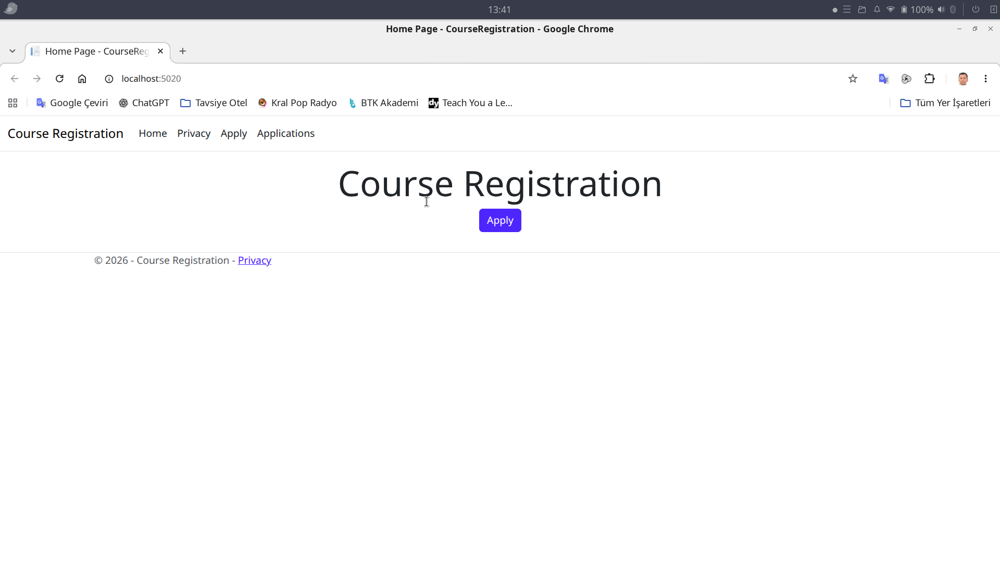
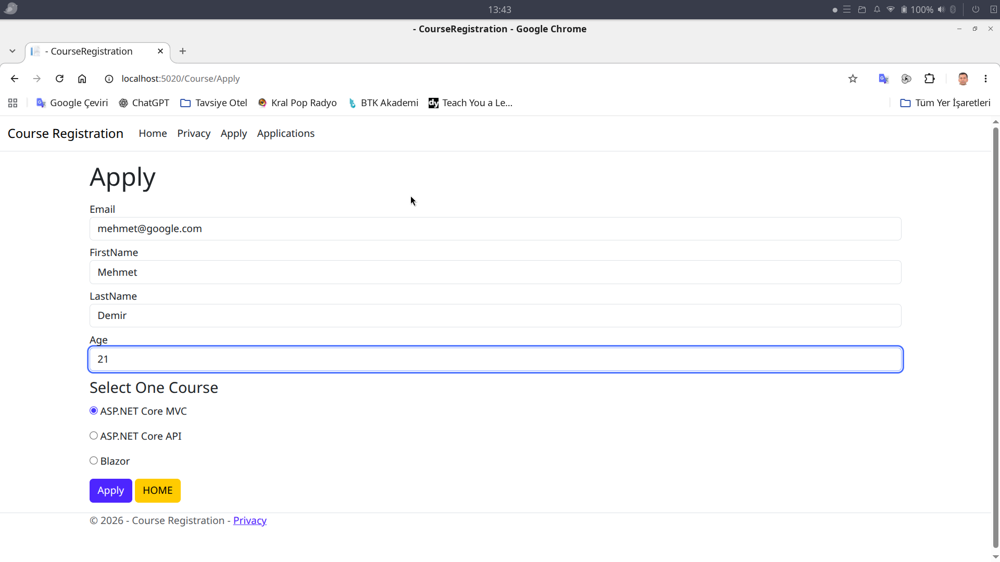
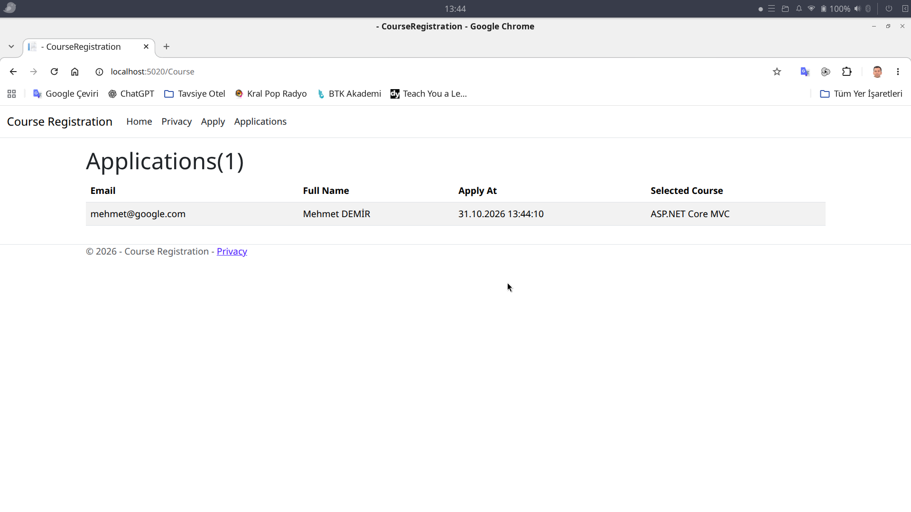
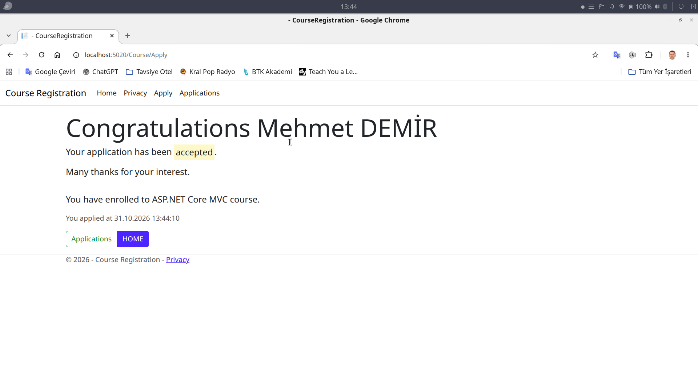

# Course Registration

ASP.NET Core MVC ile hazırlanmış basit bir kurs kayıt uygulaması. Kullanıcılar kurs başvurusu yapabilir ve mevcut başvuruları listeleyebilir.

## Özellikler

- Başvuru formunda e-posta, ad, soyad, yaş ve kurs seçimi
- E-posta, ad ve soyad için zorunlu alan doğrulaması
- Aynı e-posta ile tekrar başvuru yapılmasının engellenmesi
- Başvuruların listelenmesi ve başarılı başvuru sonrası onay ekranı

## Gereksinimler

- [.NET 10 SDK](https://dotnet.microsoft.com/download/dotnet/10.0)

## Çalıştırma

Proje klasöründe aşağıdaki komutları çalıştırın:

```bash
dotnet restore
dotnet run --launch-profile http
```

Uygulama `http://localhost:5020` adresinde açılır. HTTPS profili için:

```bash
dotnet run --launch-profile https
```

Bu profil uygulamayı `https://localhost:7030` ve `http://localhost:5020` adreslerinde başlatır. HTTPS geliştirme sertifikasıyla ilgili bir uyarı alırsanız `dotnet dev-certs https --trust` komutuyla sertifikayı güvenilir olarak işaretleyebilirsiniz.

## Kullanım

- Ana sayfa: `/`
- Başvuru formu: `/Course/Apply`
- Başvurular: `/Course`

Başvuruda ASP.NET Core MVC, ASP.NET Core API veya Blazor kurslarından biri seçilebilir.

## Ekran Görüntüleri

### Ana sayfa



### Başvuru formu



### Başvurular



### Geri bildirim



## Teknolojiler

- ASP.NET Core MVC
- Razor Views
- Bootstrap
- jQuery

## Proje yapısı

```text
Controllers/   MVC controller'ları
Models/        Başvuru modeli ve bellek içi repository
Views/         Razor sayfaları
wwwroot/       CSS, JavaScript ve istemci tarafı kütüphaneleri
Program.cs     Uygulama ve yönlendirme yapılandırması
```

## Veri saklama

Başvurular `Repository` sınıfında bellekte tutulur. Uygulama yeniden başlatıldığında kayıtlar silinir; kalıcı bir veritabanı kullanılmamaktadır.
